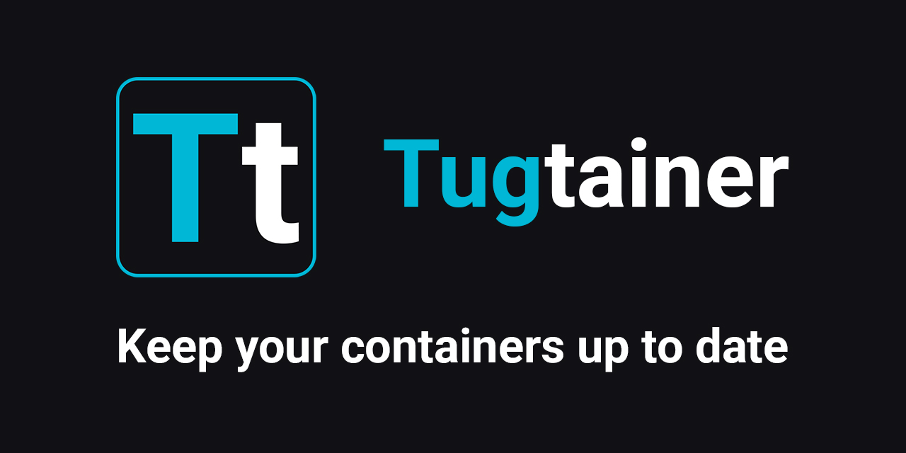

# Tugtainer



Tugtainer is a self-hosted application that automates Docker container updates. It is distributed as-is and is not intended for production use. Important data needs regular backups.

Automatic updates are disabled by default.

## Table of contents

- [Main features](#main-features)
- [Deploy](#deploy)
- [Private registries](./docs/PRIVATE_REGISTRIES.md)
- [Custom labels](./docs/CUSTOM_LABELS.md)
- [Hooks](./docs/HOOKS.md)
- [Self-update](./docs/SELF_UPDATE.md)
- [Notifications](./docs/NOTIFICATIONS.md)
- [Auth](./docs/AUTH.md)
- [API](./docs/API.md)
- [Environment](#environment)
- [Check and update](./docs/CHECK_AND_UPDATE.md)
- [Healthcheck monitoring](./docs/HEALTHCHECK_MONITOR.md)
- [Screenshots](./docs/SCREENSHOTS.md)
- [Contributing](./docs/CONTRIBUTING.md)
- [Security](./docs/SECURITY.md)

## Main features

- Web UI with authentication
- Multiple hosts
- Docker Swarm (manager detection, service checks, rolling updates, logs)
- Socket proxy
- Crontab scheduling
- Notifications
- Per-container check-only or auto-update
- Manual and scheduled check and update
- Healthcheck monitoring with restarts and notifications
- Manual and scheduled image pruning
- Linked containers (Compose and custom labels)
- Private registries
- Basic container control (start, stop, and the rest)
- Container inspect and logs

## Deploy

### Quick start

The app starts from [docker-compose.app.yml](./docker-compose.app.yml) or from:

```bash
docker volume create tugtainer_data

docker pull ghcr.io/quenary/tugtainer:1

# AGENT_SECRET is required. Set a strong, unique shared secret.
docker run -d -p 9412:80 \
    --name=tugtainer \
    --restart=unless-stopped \
    -e AGENT_SECRET="" \
    -v tugtainer_data:/tugtainer \
    -v /var/run/docker.sock:/var/run/docker.sock:ro \
    ghcr.io/quenary/tugtainer:1
```

On the first start the container logs a one-time setup code (`docker logs tugtainer`). The password is set with that code within 5 minutes. An expired code requires a restart. See [Auth](./docs/AUTH.md).

The app cannot update an agent or a socket-proxy: those containers carry the Docker API connection. A Compose project that mixes them with containers set to auto-update fails that update. Check-only mode still sends notifications; recreation stays outside the app. The app container itself updates from the UI when [self-update](./docs/SELF_UPDATE.md) is enabled.

### Remote hosts

Agent URLs that resolve to private or reserved networks are blocked by default. The check is best-effort; see [Security](./docs/SECURITY.md). The client then connects only to addresses that passed the check and keeps the original hostname, so TLS and virtual hosts stay intact. A remote agent on a LAN or a Docker network is allowed with `AGENT_ALLOW_NETWORKS` (for example `192.168.0.0/24`) and/or `AGENT_ALLOW_ENDPOINTS` (for example `10.0.0.5:9413`). See [.env.example](./.env.example). With `AGENT_ENABLED=true`, only `127.0.0.1:8001` is allowed until an exception is set.

A remote host runs the agent, from [docker-compose.agent.yml](./docker-compose.agent.yml) or from:

```bash
docker pull ghcr.io/quenary/tugtainer-agent:1

# AGENT_SECRET is required. Set a strong, unique shared secret.
docker run -d -p 9413:8001 \
    --name=tugtainer-agent \
    --restart=unless-stopped \
    -e AGENT_SECRET="" \
    -v /var/run/docker.sock:/var/run/docker.sock:ro \
    ghcr.io/quenary/tugtainer-agent:1
```

The host is added under Menu → Hosts. The agent secret matches `AGENT_SECRET` on the agent container. Backend and agent speak HTTP. A reverse proxy can terminate HTTPS.

| Setup | Host URL | SSL | Custom CA |
| --- | --- | --- | --- |
| Public CA | `https://…` | on | empty |
| Private CA or self-signed | `https://…` | on | CA PEM, or the self-signed certificate. The hostname or SAN matches the URL host. |
| TLS on the agent, no proxy | `https://…` | on | Cert and key mounted into the agent; `--ssl-certfile` and `--ssl-keyfile` via `command` (see [docker-compose.agent.yml](./docker-compose.agent.yml)). The image healthcheck calls `http://localhost:8001` and fails when the agent serves only HTTPS. |

### Socket proxy

The app and the agent can run without a direct Docker socket mount. The provided Compose files do this by default. Example proxy: [linuxserver/socket-proxy](https://hub.docker.com/r/linuxserver/socket-proxy).

| Feature | Proxy variables |
| --- | --- |
| Check | `CONTAINERS`, `IMAGES`, `POST`, `INFO`, `PING` |
| Update | `NETWORKS` |
| Logs | `ALLOW_LOGS` |
| Start, stop, restart, pause | `ALLOW_START`, `ALLOW_STOP`, `ALLOW_RESTARTS`, `ALLOW_PAUSE`, `ALLOW_UNPAUSE` |
| Swarm | `SERVICES`, `TASKS`, `NODES`, `SWARM` |

`DOCKER_HOST` on the app or the agent points at the proxy, for example `tcp://my-socket-proxy:port`.

## Environment

Most variables are optional. `AGENT_SECRET` is required. The full list is in [.env.example](./.env.example).
