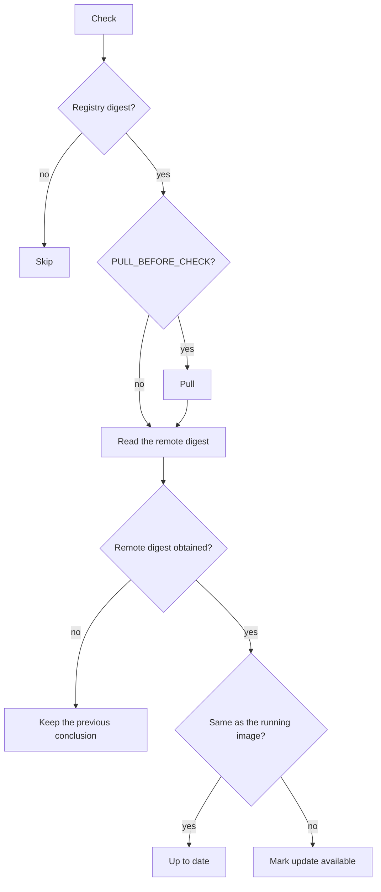
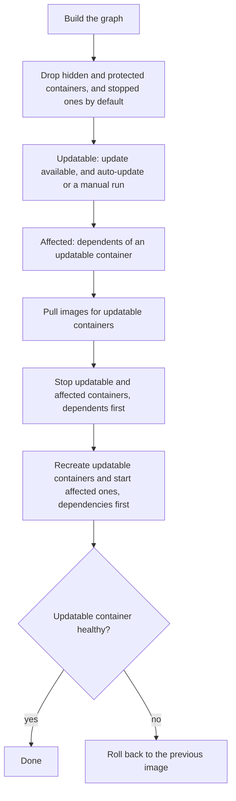

# Check and update

A container built from a local image, with no registry digest, is not checked. The same rule applies to a Swarm service.

## Check

A scheduled check covers every enabled host and every container selected for auto-check. A manual check ignores that toggle: all containers, one container, or the selected rows. A hidden container is never checked.

A failed registry lookup does not mark the container up to date. `result` stays empty and the stored availability is left as it was.

When the digests differ, the app also resolves a version and a build time for the pending image. An up-to-date container makes no extra registry request. The version comes from `org.opencontainers.image.version`, then `org.label-schema.version`. It is a publisher hint, with the same limits as [previous image](#previous-image). The build time is the image `created` field. The container card shows both. Tables keep the "Update available" tag and put the version in its tooltip.

`PULL_BEFORE_CHECK` is off by default. It pulls before the digest comparison, which matters for a registry proxy.

## Update

Containers on one host are one set. The graph comes from Compose `com.docker.compose.depends_on` (same `com.docker.compose.project` and `com.docker.compose.project.config_files`) and from [`dev.quenary.tugtainer.depends_on`](CUSTOM_LABELS.md). If A depends on B, B starts before A and stops after A. Containers with no dependency are independent.

Stopped containers are skipped unless the setting includes them. [Hidden](CUSTOM_LABELS.md) containers never enter the graph. [Protected](CUSTOM_LABELS.md) containers are skipped.

A scheduled update runs on every enabled host for containers selected for auto-update. A manual update ignores that toggle and still stops and starts dependents. Several selected rows are checked or updated together.

Check and update on the same host run one at a time. Different hosts run in parallel.

Optional [hooks](HOOKS.md) run around stop, update, and rollback when both gates are on.

## Update delay

`DELAY_UPDATE_FOR` (seconds, default `0`) waits after a new digest is detected before a scheduled update applies it. A per-container `delay_update_for` replaces the global value when set. The clock starts at the last digest change. If that time was never recorded, the wait is not applied. A manual update does not wait. Check notifications are not delayed.

## Previous image

A successful update records the image the container was running before it. The values come from the inspect the update already did.

| Field | Role |
| --- | --- |
| `previous_image_digests` | Repo digests. This is what pins the image in Compose. |
| `previous_image_tags` | Local tags. Useful for a pinned tag, not for a floating tag such as `latest`. |
| `previous_image_version` | `org.opencontainers.image.version`, then `org.label-schema.version`. A publisher hint: it may come from a base image, be a branch name, or not exist as a tag. |

A rollback or a failure does not record a previous image: the container is still on that image. If none of the three values can be read, the stored ones stay. The app does not search the registry for a tag that matches a digest. The card and [notification templates](NOTIFICATIONS.md) show the recorded values.

## Swarm

Adding a host, and later status checks, set the Swarm flag when the agent is a manager. The host dashboard then shows Swarm services.

A check inspects the image on the manager first. If that yields no repo digest, a digest already pinned in the service image (`repo:tag@sha256:…`) is used. If there is still none, the image is pulled only when `PULL_BEFORE_CHECK` is on; otherwise the service is skipped. When `PULL_BEFORE_CHECK` is on and the image was not pulled in that step, it is pulled again before the remote digest is read. A differing remote digest marks the service available. A failed lookup keeps the previous conclusion. Version and build time follow the container rules.

A scheduled check includes services with check enabled. A scheduled update includes services with update enabled and an available image. A manual check or update ignores those switches. A manual update does not require an available image.

An update calls the agent's service update and reports `updated` when Swarm accepts the call. Swarm applies the service's own rolling update and health configuration. The table then shows that status (`updating`, `completed`, `rollback_completed`) and the service logs. There is no app-level rollback and no previous-image record.
