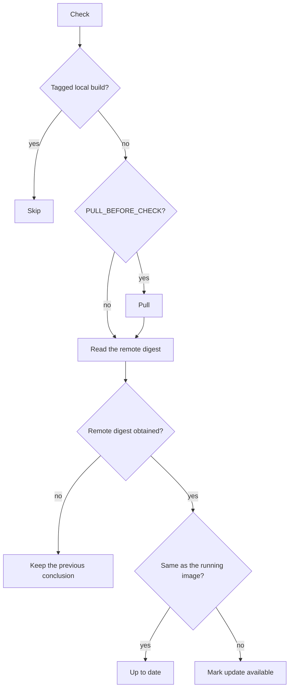
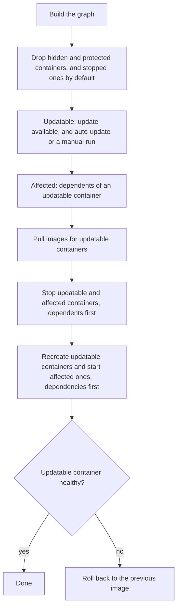

# Check and update

A locally built image that still has a tag and no known digest is not checked. An untagged image with no repo digests is compared with the registry. A `<none>` tag, including `<none>:<none>`, is untagged. The same rules apply to a Swarm service, except a pinned service digest is still checked when the manager copy has tags and no RepoDigests.

## Check

A scheduled check covers every enabled host and every container selected for auto-check. A manual check ignores that toggle: all containers, one container, or the selected rows. A hidden container is never checked. A protected container is checked and stays visible; start, stop, and update still refuse it.

An image reference may include a registry port (`localhost:5000/app:tag`) or a digest (`repo@sha256:…`). The digest is the manifest reference, so a pinned image stays up to date while that digest is published. The tag in `repo:tag@sha256:…` is not used for the lookup.

A failed registry lookup does not mark the container up to date. `result` stays empty and the stored availability is left as it was.

When the digests differ, the app also resolves a version and a build time for the pending image. An up-to-date container makes no extra registry request. The version comes from `org.opencontainers.image.version`, then `org.label-schema.version`. It is a publisher hint, with the same limits as [previous image](#previous-image). The build time is the image `created` field. The container card shows both. Tables keep the "Update available" tag and put the version in its tooltip.

`PULL_BEFORE_CHECK` is off by default. It pulls before the digest comparison, which matters for a registry proxy.

## Update

Containers on one host are one set. The graph comes from Compose `com.docker.compose.depends_on` (same `com.docker.compose.project` and `com.docker.compose.project.config_files`) and from [`dev.quenary.tugtainer.depends_on`](CUSTOM_LABELS.md). If A depends on B, B starts before A and stops after A. Containers with no dependency are independent.

Stopped containers are skipped unless the setting includes them. [Hidden](CUSTOM_LABELS.md) containers never enter the graph. [Protected](CUSTOM_LABELS.md) containers are skipped.

A scheduled update runs on every enabled host for containers selected for auto-update. A manual update ignores that toggle and still stops and starts dependents. Several selected rows are checked or updated together.

Check and update on the same host run one at a time. Different hosts run in parallel.

Optional [hooks](HOOKS.md) run around stop, update, and rollback when both gates are on.

### Configuration preservation and preflight

Container recreation sends the Engine API create body:

- All labels, environment variables, mounts, port bindings, device requests (GPUs), ulimits, and sysctls are preserved faithfully.
- Anonymous volume identities are retained across recreations.
- Secondary networks are attached before container startup.
- **Preflight validation**: the new container config and the rollback config are both turned into engine create requests before anything is stopped or removed. That check includes unsupported fields, size and device parsing, healthcheck and mount values, and a per-runtime capability policy. Docker uses the negotiated API (image mounts and `GwPriority` need API 1.48). Podman uses its engine version, Libpod API, and compat API, and never the Docker 1.44 floor. Docker-only fields fail with a Podman reason. A static MAC address is kept on Podman 5.0 and newer, including the 5.7 (compat API 1.41) and 6.x (compat API 1.44) shapes; an older Podman engine that cannot accept it fails preflight instead of dropping the address. Any failure while preparing that config aborts the container's update, including a parse error that is not a `RuntimePreflightError`. The original container keeps running, and dependents are left running unless another container in the plan is still going to be recreated. The reason is stored on the job result and included in the notification.
- Recreation uses the Docker-compatible `POST /containers/create` endpoint on Docker and on Podman. A container that records a cidfile fails preflight and stays running. A container managed by systemd or Quadlet (label or environment `PODMAN_SYSTEMD_UNIT`) also fails preflight before it is stopped; use `podman auto-update` for those units. A Swarm task container (`com.docker.swarm.service.id`) fails preflight before it is stopped; update the Swarm service instead. Env files, label files, a host-env copy, pods, a pull policy, and `systemd` are not engine API fields; a create request that sets them fails before the container is replaced. The same create-request check runs again in the self-update helper before the app container is renamed.

## Update delay

`DELAY_UPDATE_FOR` (seconds, default `0`) waits after a new digest is detected before a scheduled update applies it. A per-container `delay_update_for` replaces the global value when set. The clock starts at the last digest change. If that time was never recorded, the wait is not applied. A manual update does not wait. Check notifications are not delayed. Scheduled Swarm service updates use the global value only. They have no per-service override.

## Previous image

A successful update records the image the container was running before it. The values come from the inspect the update already did.

| Field                    | Role                                                                                                                                                           |
| ------------------------ | -------------------------------------------------------------------------------------------------------------------------------------------------------------- |
| `previous_image_digests` | Repo digests. This is what pins the image in Compose.                                                                                                          |
| `previous_image_tags`    | Local tags. Useful for a pinned tag, not for a floating tag such as `latest`.                                                                                  |
| `previous_image_version` | `org.opencontainers.image.version`, then `org.label-schema.version`. A publisher hint: it may come from a base image, be a branch name, or not exist as a tag. |

A rollback or a failure does not record a previous image: the container is still on that image. If none of the three values can be read, the stored ones stay. The app does not search the registry for a tag that matches a digest. The card and [notification templates](NOTIFICATIONS.md) show the recorded values.

## Swarm

Adding a host, and later status checks, set the Swarm flag when the agent is a manager. The host dashboard then shows Swarm services. A task container stays in the container list, is not checked against the registry, and is not marked available. The containers page does not offer check or update controls for it. Container update refuses it.

A check inspects the image on the manager first. If that yields no repo digest, a digest already pinned in the service image (`repo:tag@sha256:…`) is used, including when that manager copy has tags and no RepoDigests. If there is still none, the image is pulled only when `PULL_BEFORE_CHECK` is on; otherwise the service is skipped. When `PULL_BEFORE_CHECK` is on and the image was not pulled in that step, it is pulled again before the remote digest is read. A differing remote digest marks the service available. A failed lookup keeps the previous conclusion. Version and build time follow the container rules.

A scheduled check runs for every enabled host, then checks services on a Swarm manager when `check_enabled` is on. A scheduled update does the same for services with `update_enabled` and an available image, after `DELAY_UPDATE_FOR`. Both flags stay off by default. The services page check or update ignores those switches, and that update does not require an available image. Global "Update all" updates only services that already have an update available, and it does not wait. Container and service results for one host are one notification. If the Swarm flag is stale and the agent answers 503, the service step logs a warning and the container result is kept.

An update of a tagged service (`repo:tag` or `repo:tag@sha256:old`) asks the engine for the current registry digest (`GET /distribution/{name}/json`, with `X-Registry-Auth` when the registry has credentials) and writes `repo:tag@sha256:new`. The socket proxy needs `DISTRIBUTION=1` for that call. An unchanged digest is not submitted, and that update is reported as `not_available`. A digest-only reference is sent as it is. A registry or decode failure is reported and the service spec is left alone. The update reports `updated` only when Swarm accepts the call. Swarm applies the service's own rolling update and health configuration. The table then shows that status (`updating`, `completed`, `rollback_completed`) and the service logs. There is no app-level rollback and no previous-image record.
