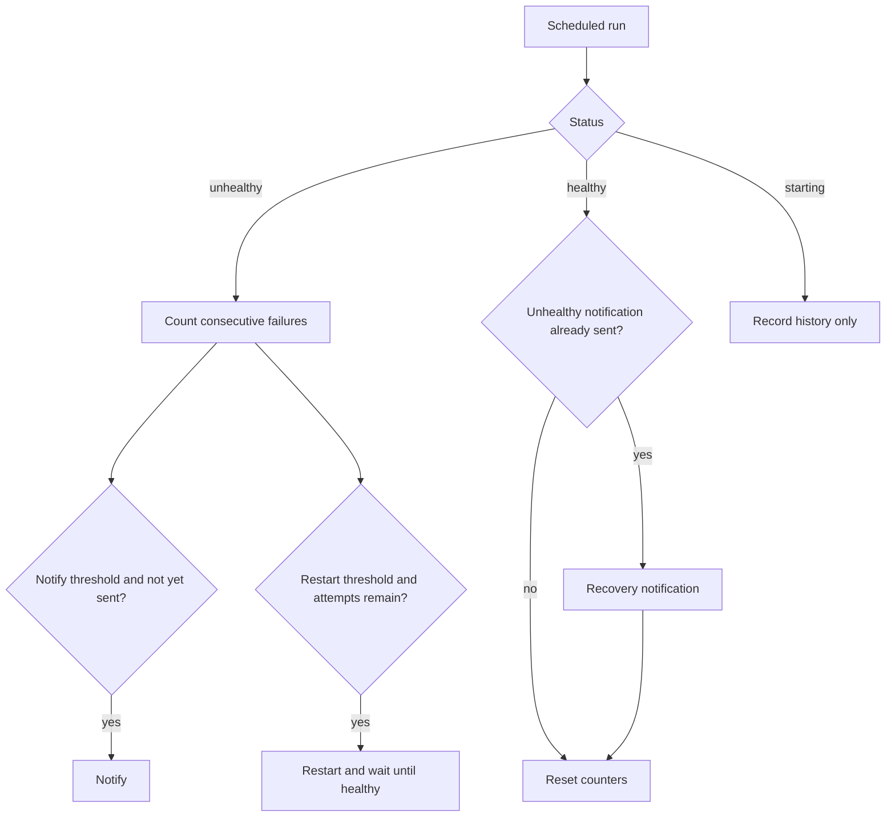

# Healthcheck monitoring

The app inspects Docker healthchecks on every enabled host. Containers without a healthcheck are skipped. It records status changes, can restart a failing container, sends notifications, and keeps a history.

A restart is attempted when `consecutive_failures` reaches `(restart_attempts + 1) * HEALTH_MONITOR_N_TO_RESTART`, and at most `HEALTH_MONITOR_RESTART_ATTEMPTS` times. `HEALTH_MONITOR_N_TO_RESTART` defaults to `-1`, which disables restarts. `HEALTH_MONITOR_N_TO_NTFY` below `1` disables notifications. Schedule is `HEALTH_MONITOR_CRON_EXPR`.

History older than `HEALTH_MONITOR_HISTORY_DAYS` is deleted. `0` or below keeps it.

The wait after a restart uses the container override when set, otherwise the host `container_hc_timeout` (default 60 seconds). `protected` does not block this restart. A `starting` status is stored in history and does not notify, restart, or reset counters.

Settings live under Menu → Settings. The host dashboard summarizes healthy and unhealthy containers. The history view is `/hosts/:id/health` (time, container, status, restart, notification). Notification content is in [Notifications](./NOTIFICATIONS.md#health-monitor).

| Setting | Default |
| --- | --- |
| `HEALTH_MONITOR_CRON_EXPR` | `*/3 * * * *` |
| `HEALTH_MONITOR_N_TO_RESTART` | `-1` |
| `HEALTH_MONITOR_N_TO_NTFY` | `3` |
| `HEALTH_MONITOR_RESTART_ATTEMPTS` | `3` |
| `HEALTH_MONITOR_HISTORY_DAYS` | `7` |
| `HEALTH_MONITOR_NTFY_BODY_TMPL` | built-in template |
