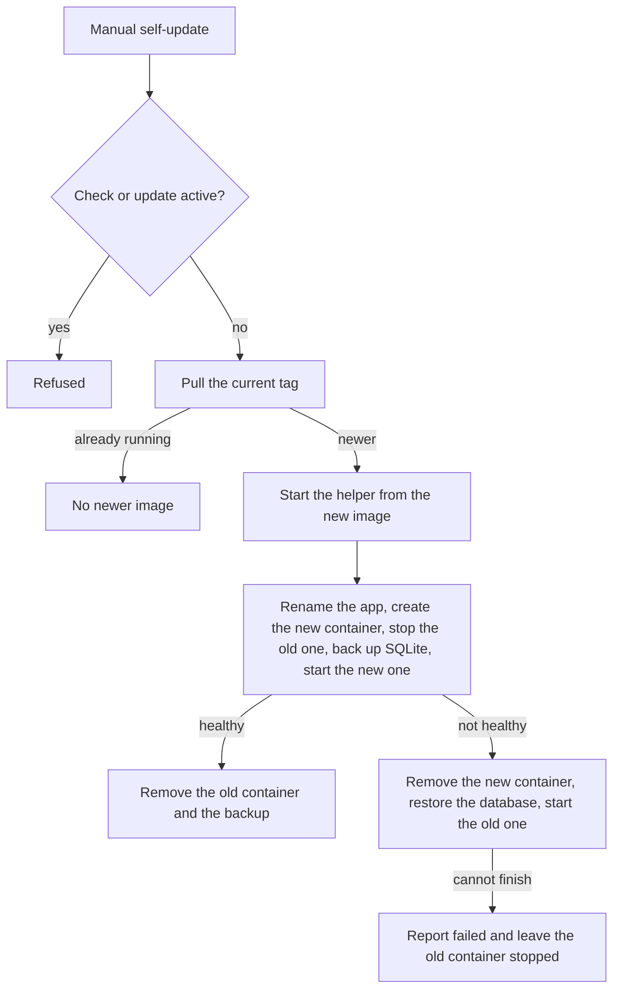

# Self-update

The app can replace its own container. The feature is off until `ALLOW_SELF_UPDATE=true`. It starts from the "Update available" tag next to the version, then **Self-update**. The UI drops while the container is replaced, then reloads and shows the result. The same result goes to the configured [notification](NOTIFICATIONS.md) URLs. If the app does not come back, the page stops waiting and shows an error.

The agent and the socket-proxy are not part of this update.

A running or queued check or update refuses the self-update. From the moment it starts until the app process is gone, new scheduled and manual jobs stay queued.

The running process cannot recreate its own container, so a short-lived helper container from the new image performs the swap.



The helper is named `<name>-self-update`. It receives only the app's Docker access (`DOCKER_HOST` and networks, or the socket mount) and the data volume. The label `dev.quenary.tugtainer.protected` keeps scheduled updates away from it, and it is removed when it exits. The old container is renamed `<name>-old` and is removed only after the new one is healthy. A pulled image that matches the running one stops with "No newer image". A pinned tag such as `:1.44.3` follows that tag; the dialog's GitHub comparison can disagree with it.

If the new container cannot be removed, or the database cannot be restored, rollback stops and reports `failed`. The old version does not start beside the new one or on a migrated database. After startup the app (new or restored) waits for the helper, reports the result once, and drops the helper's journal. A leftover `<name>-old` is removed only when that journal records it as the old container of a successful update.

## Requirements

- `/tugtainer` is a volume or a bind mount. Otherwise the update is refused.
- With the default SQLite database, the file lives inside `/tugtainer`. Other databases are not copied, so a failed update cannot undo their migrations.
- The helper uses the app's Docker access. `DOCKER_TLS_VERIFY` and `DOCKER_CERT_PATH` are not passed through.
- The provided socket-proxy allows renames when `CONTAINERS=1` and `POST=1`.
- Without `JWT_SECRET_KEY` the new container generates a new secret and existing sessions end.

## Recovery

A helper result of `failed` (rollback did not finish) or `interrupted` (the helper exited without a result) leaves the containers for an operator. Nothing else rolls back: `<name>-old` stays stopped, and a new container may already exist under the original name, possibly on a migrated database.

```bash
docker ps -a --filter name=tugtainer
docker logs <name>-self-update
cat /path/to/tugtainer_data/self_update/state.json
```

`state.json` lists the steps that finished. The database copy remains in `self_update/backup/`. Recovery is: remove the new container if it exists, copy the backup files back beside `tugtainer.db`, rename `<name>-old` to `<name>`, and start it.
